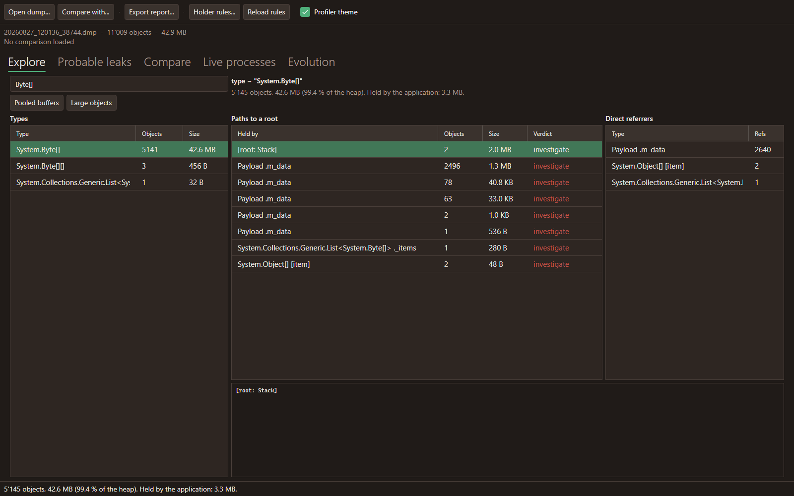
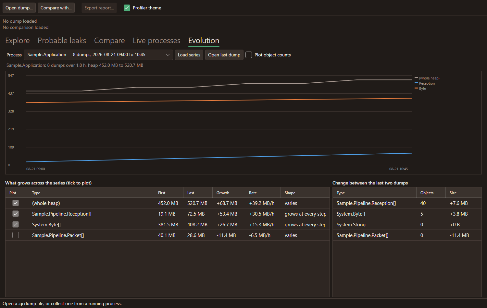
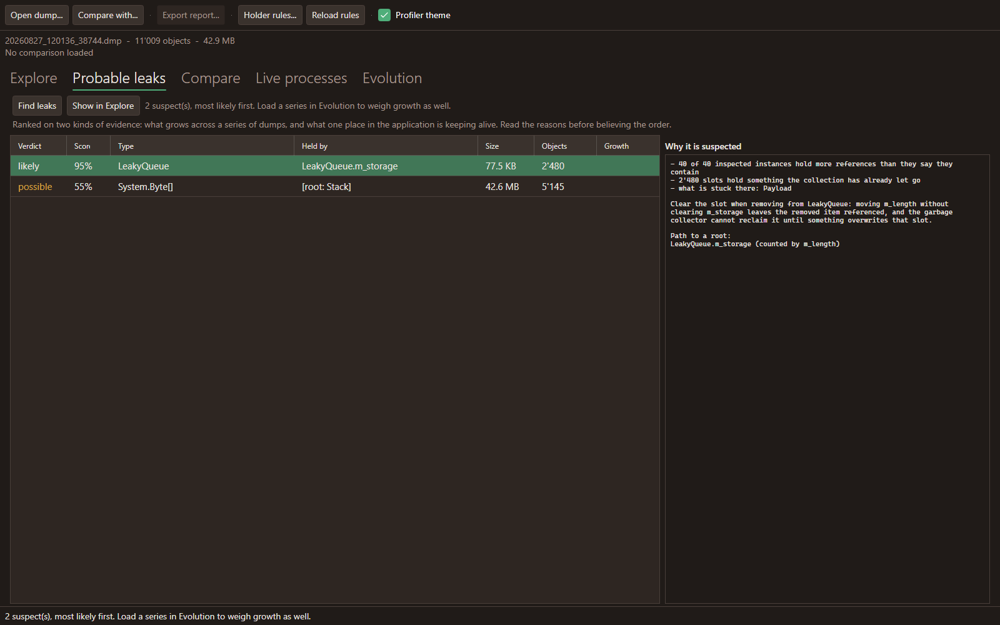

# No Frills .NET Memory Profiler

Finds what keeps memory alive in a .NET process: opens a `.gcdump` heap dump (or collects one from
a running process), lists what is on the heap, and for any selection of objects reports **who holds
them**, from the direct referrer up to the garbage collector root.

It is built around the question that a generic heap viewer answers badly: *this memory should have
been released, what is still pointing at it?*



## Look

Dark, earthy neutrals with a single vivid accent, from the palette in
[doc/PALETTE.md](doc/PALETTE.md). The rule the interface follows is the palette's own: the accent
marks what can be acted on or what is alive (a hovered button, the selected row), and everything
else stays neutral. The state colours - warning, error - are for states only, never decoration:
the holders worth investigating, the strength of a suspicion, a dump that came back truncated.

The colours live in `Theme/Colors.axaml` as given, with `Theme/Theme.axaml` pointing the Fluent
theme's own accent at ours so the selection and the focus rings follow.

The palette also records the official .NET purple and says where it may appear: the corner chip of
the detailed icon, and nowhere else. It is written down in `Theme/Colors.axaml` as a colour and
given no brush, so it stays part of the identity without being paintable, and a test keeps it that
way.

The icon set has two variants, and which one is used matters. Below about 48 pixels the detailed
drawing loses its whiskers and its browns sink into a dark title bar, so the small sizes are a plain
accent badge instead. `Assets/icon-32.png` is therefore what the window carries, since the window
icon is what a title bar, a task bar and the alt-tab list show. `Assets/icon-256.png` is the detailed
drawing, for anywhere with room for it. See [doc/ICONS.md](doc/ICONS.md).

`Assets/app.ico` is assembled from the set's PNGs by [doc/assemble-app-icon.py](doc/assemble-app-icon.py),
because the icon delivered with the set holds a single 16 pixel image, which the shell then scales up
for the desktop shortcut and the alt-tab list. Run that script after dropping in a new set.

**Profiler theme** in the toolbar turns this off in favour of whatever the desktop uses. The look is
read once at startup, so the choice applies the next time the profiler starts: swapping style sheets
under a live window leaves controls holding brushes from the sheet that just left. Two sheets, one
setting - `Theme/Palette.axaml` paints everything, `Theme/SystemPalette.axaml` leaves the colours to
the system and keeps only what carries meaning: the holders worth investigating, the strength of a
suspicion, the separators. Colour that says something survives; colour that decorates does not.

## Why not PerfView or dotMemory

Those show everything, which means every investigation starts with the same manual triage. This one
does that triage for you:

- **Expected holders are labelled, not reported as findings.** A buffer sitting free in its pool, an
  object queued for finalization and a buffer pinned for a transfer all look like retention and are
  all normal. They are set aside, so what is left is what to investigate. The pools of the framework
  are recognised by name, and your own are one rule away.
- **Pooled buffers are one click.** A preset selects the buffers of a pool by size, so there is no
  working out which object size to look for.
- **Referrers that reference everything are stepped over.** The bookkeeping a pool keeps over what
  it has lent out refers to every buffer by design; left alone it claims all of them and hides the
  real holder.



## Using it

```
dotnet run --project src/NoFrills.MemoryProfiler.App
```

1. **Open dump...** loads a `.gcdump` or a full `.dmp`. A 100 MB dump (about 5 million objects)
   takes a few seconds.
2. **Explore** is one view, because choosing what to look at and seeing what holds it is one
   question. The list on the left filters as you type; **Pooled buffers** and **Large objects** are
   presets for the two usual cases. Choosing a row analyzes it and the answer appears beside it:
   every way those objects are kept alive, largest first, each with a verdict. Read the rows marked
   *investigate*; the others are expected. Selecting one shows the full path to a root underneath.
3. **Compare** loads a second dump of the same process taken later. What grew between the two is
   what accumulates, which finds a leak faster than reading either dump.
4. **Live processes** lists the .NET processes that can be profiled, filtered as you type, and
   refreshing itself while the tab is shown. **Collect and open** takes a dump and opens it straight
   away. Dumps are filed under `<root>/<process name>/`, so the dumps of one process are a series by
   construction; the root folder is set here and remembered. **Full dumps** switches the button and
   the schedule from gcdumps to full process dumps: no ten million object cap (dotnet-gcdump
   silently truncates beyond it) and field precise holders ("RequestQueue .m_pending" instead of a
   bare type), against files the size of the process memory. Everything reads both formats: open,
   holders, compare, evolution.
5. **Every N minutes / Start schedule** keeps collecting from the selected process on its own, which
   is how a slow leak gets caught: start it, leave it running, look at the evolution afterwards.
   **Keep at most** deletes the oldest dumps so a long session does not fill the disk. The schedule
   stops by itself when the target process ends - noticed before a collection or by the collection
   failing - and says so in the status and the collection log. It runs as long as the profiler
   window is open. Every collection, failure and retry is written to `collection.log` in the dump
   root folder, shown live in the Collection log panel.
6. **Evolution** reads a whole series: pick the process, **Load series**, and the chart shows how the
   heap and the types moved. The table ranks types by how much they grew, and says whether each one
   *grows at every step* (accumulating) or merely *varies* (used and released). Tick any type to add
   its curve. The right hand table is the change between the last two dumps.
7. **Probable leaks** ranks what is most likely to be leaking, with the evidence for each. It is
   worth more with a series loaded in Evolution, because growth is evidence a single dump cannot
   give. **Show in Explore** opens the suspect with its holders already showing.
8. **Export report...** writes the analysis as markdown, to paste into an issue.
9. **Record GC timeline** (Live processes) answers what no dump can: what triggers the collections
   and how long they stop the threads. It listens to the garbage collector of the selected process
   for the chosen number of seconds, without pausing it, and files the recording (`.nettrace`)
   beside the dumps; **Open recording...** reads one again. The **GC timeline** tab plots every
   pause against time, sums the pauses up per generation (count, total, p50, p95, max, and what
   triggered them), and ranks what allocated by type, by thread and by stack. A stack is cut to its
   first frames outside the framework: the framework frames say how memory is allocated, which is
   always the same, the ones above them say why. The allocations are samples, one about every
   100 KB, so read them as proportions. Its own **Export report...** writes it as markdown.



## How the leaks are ranked

A leak is not memory that is large, it is memory that grows and is held by something that should
have let go. Two kinds of evidence are combined, because either alone misleads:

- **Growth**, from a series: a type larger at every step is accumulating; one that goes up and down
  is being used and released.
- **Attribution**, from the latest dump: how much of the type the application itself holds, once the
  pool, finalization and pinning are set aside, and whether one place holds most of it.

Size then decides which suspect to read first. Every finding lists the reasons that produced its
score and the path to a root, because a detector that cannot be argued with is one nobody trusts.

On a **full dump** a third kind of evidence is added, and it is not a guess: the fields of the
collections are read, and any collection holding more references than it says it contains is
reported. That is the shape of the bug this profiler was written after - removing an item by moving
an index, without clearing the slot it occupied, leaves the item referenced and unreclaimable until
something overwrites that slot, which on a quiet channel can be minutes or never. The test is index
blind, so it holds for a list, a builder, and a ring buffer whose live range wraps.

Two limits are stated rather than hidden: on a truncated dump, what could not be attributed is
reported as unknown instead of counted against the type; and a holder is named as the first ordinary
object *after* the collections on the path, since the array that refers to a leaked object directly
says nothing (there is one per object).

## Collecting dumps

The profiler collects them itself (Live processes tab), or use the tool:

```
dotnet tool install --global dotnet-gcdump
dotnet-gcdump collect -p <pid>
```

Two dumps twenty minutes apart are worth more than one: the comparison separates what is stable
from what grows. A scheduled series of five or six is better still, because a type that rises at
every step cannot be explained by having caught the process at a bad moment.

Collecting pauses the target for the length of a blocking collection, a few seconds on a large heap,
which is why the shortest interval allowed is one minute.

## How it reads a dump

`.gcdump` is a serialized object graph. The reader for it (`Graphs.MemoryGraph`, `GCHeapDump`,
`RefGraph`) and the live collector (`EventPipeDotNetHeapDumper`) are published only inside the
`dotnet-gcdump` global tool: no NuGet package exposes them. `lib/` holds a copy of those assemblies
so the build does not depend on which version of the tool happens to be installed. See
[lib/README.md](lib/README.md) to refresh them.

Two different graph walks answer two different questions:

- **Direct referrers** use the reverse edges (`RefGraph`), so *every* reference to an object is
  counted, not only the one on a shortest path.
- **Paths to a root** use a breadth first walk from the roots, so each object is explained by its
  shortest path, and referrers configured as ignored are stepped over.

Memory: the profiler needs roughly twice the dump's heap size, more once reverse edges are built.
A 1.2 GB heap is comfortable on a normal desktop.

A series cannot be held that way: ten dumps of a large process would be more than a machine has. So
each dump of a series is loaded once, reduced to per type totals, and released; the result is cached
in a `.summary.json` next to the dump, which makes opening the same series again immediate. Only the
dump being analyzed in the holder view is ever fully in memory.

## Layout

| Project | What it is |
|---|---|
| `src/NoFrills.MemoryProfiler.Core` | Loading, selection, holder analysis, comparison, collection, report writing. No UI. |
| `src/NoFrills.MemoryProfiler.App` | Avalonia desktop application. |
| `tests/NoFrills.MemoryProfiler.Tests` | Analysis tests, run against a reference dump. |
| `tests/NoFrills.MemoryProfiler.UiTests` | Headless tests that build the real window, and render it to a picture. |
| `tests/NoFrills.MemoryProfiler.Sleeper` | A target process for the tests: allocates, builds a leaking collection and a healthy one, then waits. Started with `allocate`, it churns garbage and induces collections instead, for the GC timeline; `tests/NoFrills.MemoryProfiler.Tests/Fixtures/allocating-sleeper.nettrace` is a recording of it. |

The collection tests start a real process, collect from it on a schedule and read the result back,
so the whole chain is covered rather than mocked.

The stale slot check is tested against a process built to contain the bug and its opposite: forty
queues that clear the slot they remove from, and forty that only move an index. Both hold the same
two items and look identical from outside. Finding the second and leaving the first alone is what
the tests assert, because a check that accuses healthy collections is worse than no check.

The tests that read a real dump need one on the machine: set `MEMORYPROFILER_TEST_DUMPS` to a
folder holding them (searched recursively, and several folders can be given separated by `;`), with
a `reference-expectations.json` beside them saying what they should be found to contain, and they
run. Without either they are ignored rather than
failed, so a fresh clone builds and tests green. The dumps are far too large to keep in the
repository, and what is in them is not this repository's to describe.

The analysis tests check the profiler still reaches the conclusions of the investigation it was
written for: of 402 live pool buffers in that heap, 145 free in the pool, 55 dead waiting for a
finalizer, 16 pinned, and the rest held by two places in the application that had let go of them
already. What those places are called is knowledge about someone's heap rather than about this
profiler, so it lives beside the dumps, in a `reference-expectations.json` naming what should be
found. Without the dumps and that file the tests are ignored.

## Teaching it your own pools

The defaults know the pools of the framework, objects awaiting finalization and pinned buffers.
They cannot know yours: a pool written for one application is recognisable only to whoever wrote
it, and an unrecognised pool is reported as the largest leak in the heap, every single time,
because a pool holding its own free buffers looks exactly like a leak from the outside.

**Holder rules...** in the toolbar writes and opens a file naming what your application holds on to
legitimately. **Reload rules** applies an edit without restarting.

```json
{
  "rules": [
    { "pattern": "MyBufferPool", "category": "Pooled", "explanation": "Free buffer waiting in the pool" },
    { "pattern": "MyCache", "category": "Instrumentation", "explanation": "Cache, cleared on demand" }
  ]
}
```

It lives in `%APPDATA%\NoFrills.MemoryProfiler\holder-rules.json`. A pattern is looked for
anywhere in the names along a path to a root, so a namespace or a fragment works as well as a full
type name. The categories are `Pooled`, `AwaitingFinalizer`, `Pinned`, `Instrumentation` — all
treated as expected — and `Application`, which is what gets reported as worth investigating. A rule
that names a category that does not exist is dropped and said out loud in the status bar, rather
than silently leaving you to think your pool is known.

Your rules are read **ahead** of the built-in ones and win. The defaults recognise a pool by a
fragment of its name, which is a guess; you naming your own type is not. So a `MyObjectPoolWrapper`
that is really a cache can be declared `Application`, and the wording you choose for your own heap
is the wording you see.

The same rules from code, for a tool built on the library:

```csharp
var classifier = HolderClassifier.Default
    .With(new HolderRule("MyBufferPool", HolderCategory.Pooled, "Free buffer waiting in the pool"));

// ...or read from the file the application uses:
var configured = HolderRuleFile.Classifier();
```

`HolderAnalysisOptions.IgnoredReferrerPatterns` is the other half: types that reference so many
objects that they explain nothing.
